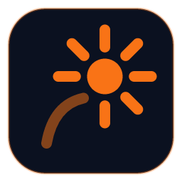

  
  <h1>Flare Tools</h1>
  
Build, sign and publish DayZ mods.

  

    
    
  

Flare Tools is a desktop app for DayZ modders, for Windows. Add a mod once and building it is one click: it packs the
mod with pboProject, signs it and lays out the `@Mod` folder. Then publish it to the Steam Workshop from the same app.

## Download

Get the latest installer from **[Releases](https://github.com/CallMeLewis/flare-tools/releases/latest)**. The app keeps
itself up to date after that. See what changed in each version in [CHANGELOG.md](CHANGELOG.md).

Windows may say it protected your PC while the app is new and few people have downloaded it: choose More info, check
the publisher is Lewis Caddick, then choose Run anyway.

You need:

- Windows 10 or 11
- [Mikero's tools](https://mikero.bytex.digital/) (pboProject)
- Bohemia Interactive's DayZ Tools from Steam (for DSSignFile), and a `.biprivatekey` with its `.bikey` next to it
- A mounted P: drive
- For the Workshop tool: Steam, signed in to an account that owns DayZ

The app finds pboProject, the P: drive, DSSignFile and pboProject's private key on first run. You can change any of
them in Settings.

## What it does

- **Build** packs mods with pboProject. Add a mod once, with its source folder, output folder and options, and from
  then on building it is one click (or <kbd>Ctrl</kbd>+<kbd>B</kbd>).
- Works out each mod's prefix and PBOs for you, and links the mod onto the P: drive for the build when it lives
  somewhere else.
- Signs each PBO and copies the matching `.bikey` into the mod's `keys` folder.
- Shows pboProject's log as it runs, and keeps a history of every build.
- **Workshop** creates and updates your DayZ Steam Workshop items: the page (title, description, tags, visibility and
  preview) and the files, which can come straight from a mod's build output.
- Light and dark themes, and stable and beta update channels.

[How it works](docs/how-it-works.md) explains prefixes, PBOs and what a build does in detail.

## Building it yourself

See [docs/development.md](docs/development.md) for running it from source and how releases are made.

## Licence

Flare Tools is free software under the [GNU General Public License v3](LICENSE). The name and icon aren't covered by
the licence: if you share a modified version, give it a name and icon of its own. See [TRADEMARKS.md](TRADEMARKS.md).
Third-party components, including Steam's library and the font, are listed in [NOTICE.md](NOTICE.md).

Flare Tools is an independent project. It is not made or endorsed by Bohemia Interactive. DayZ is a trademark of
Bohemia Interactive a.s.
